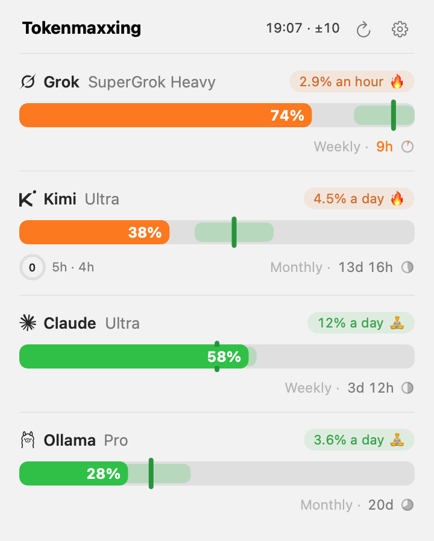
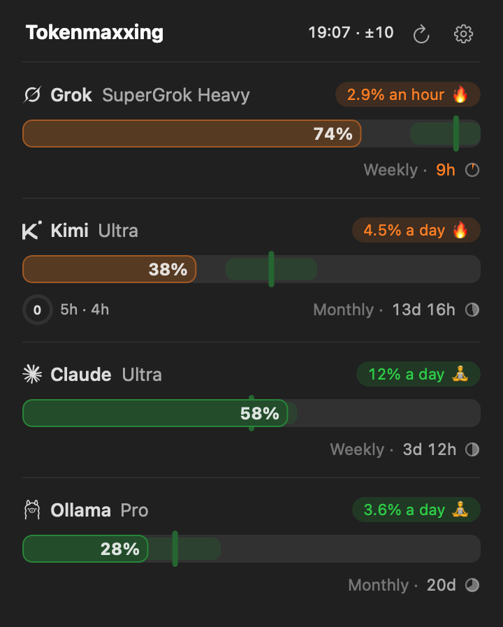

# Tokenmaxxing

A macOS menu bar utility that shows, for each AI subscription, how the quota you have used compares with the share of the period already gone.

- **Below the band**: orange bar. The pill is how much you can still use per day, or per hour when less than a day is left (`18% a day`), and 🔥.
- **Inside the band**: green bar. The same pill, and 🧘.
- **Above the band**: red bar. The pill is the same per-day or per-hour quota as a ceiling (`max 4% an hour`), or `Used up` at 100%, and 🛑.

In the last 12 hours of a period of at least a day, below the band and with at least 20% left, the countdown and the pie turn orange, and a ⚡︎ appears in the menu bar.

Each subscription is a card: logo, name, plan, and the quota pill. The bar's fill is your usage, the green band is the on-pace range, and the tick is where you should be by now. Under the bar: the kind of limit, a compact countdown (`13d 16h`), and a pie of the time still left. A secondary window, such as 5 hours, is a ring with its percent to the left of that row. Click the card for Used, Expected, Ideal pace, Projection and Reset. Stale data is shown without a verdict: the numbers stay on a neutral bar, without the pill, the band or the tick, and the card says "stale data".

The menu bar shows a logo and the percent used for each subscription. The percent uses the bar's color. ⚙︎ → Menu bar → Logos (the default) or Letters (the initial instead of the logo).

Dark mode follows the macOS appearance and uses the system colors.

| Light | Dark |
|---|---|
|  |  |

*(sample data)*

The interface is in English and Italian. It follows the system language, and you can change it from ⚙︎ → Language.

## The math

```
elapsed  = (period length − time to reset) / period length
expected = elapsed × 100
band     = expected ± 10 points   (adjustable: ±5, ±10, ±15, ±20)
```

- Below the band: `remaining / days to reset` per day, and `remaining / hours to reset` per hour. Waste = `100 − projection at the current pace`.
- Above the band: run-out date = `now + remaining / current pace`, when that is before the reset.

**Plan advice.** The app estimates whether a bigger or smaller plan would suit you better. It uses your projected end-of-period usage, averaged with your completed periods once there are some; with no history yet, the projection is discounted by 10% because a single partial period is noisy. The price ladders live in `TMModel.m`, and you can replace them with `~/Library/Application Support/Tokenmaxxing/plans.json` (⚙︎ → *Open plans.json*). When a provider does not publish the quota ratio between its plans, the advice is marked as an *estimate*.

## Where the data comes from

These reads do not spend quota, with one small exception: at every start Claude Code itself sends a one-token "quota" message to the model. It cannot be turned off without breaking `/usage` (`CLAUDE_CODE_DISABLE_NONESSENTIAL_TRAFFIC=1` makes it fail), so each Claude read costs one token (one read per refresh: every 15 to 60 minutes, set in ⚙︎ → *Refresh every*).

| Subscription | Source | Windows |
|---|---|---|
| Grok (`grok` CLI) | opens the TUI in a pseudo-terminal, types `/usage` and closes it without sending any message | week |
| Kimi Code (`kimi` CLI) | same as Grok, with `/usage` in the TUI | month (or week), 5 hours |
| Claude (Claude Code subscription) | `claude` TUI `/usage` (no MCP servers, no permission prompts) is the primary source; ⚙︎ → Connect Claude… is an optional read-only keychain fallback kept in memory until expiry, with no token refresh and no keychain writes | week (and 5 hours when shown) |
| Ollama (cloud) | the local Ollama server's `/api/balance` endpoint | week, session |

- **Open at login**: the first time the app runs from /Applications, it registers itself to open at login. You can turn this off from ⚙︎ → *Open at login*, and it stays off.
- Reads run every 20 minutes (15, 20, 30 or 60 from the menu), one at a time; a full round usually takes 25–60 seconds. The verdict is recomputed every minute, because it also depends on time passing.
- **Claude**: the normal source is the `claude` TUI: the app reads `/usage` from it, with no token involved. Optional fallback: ⚙︎ → *Connect Claude…* reads "Claude Code-credentials" from the keychain once (macOS may ask). That read keeps the access token, its expiry and the plan name in memory only until the token expires. The app never refreshes the token and never writes to the keychain. Automatic reads never touch the keychain. When the login is expired, open `claude` once so it renews its own login, then choose *Connect Claude…* again. Tokens are never written to disk in clear text or to logs.
- **Kimi**: the CLI does not show the plan, so you set it from the ⚙︎ menu.
- If a CLI is not in a standard location: `defaults write com.ozonllp.tokenmaxxing grokPath /path/to/grok` (or `kimiPath`). For a non-local Ollama server: `ollamaURL`.
- No telemetry. Grok, Kimi and Claude are read through their own CLIs and Ollama is local; the app itself calls the network only for the optional Claude keychain fallback.

`~/Library/Application Support/Tokenmaxxing/` holds only `history.json` (the final value of each period, for the plan advice) and, if you create it, `plans.json`.

## Build

Only the Command Line Tools are needed (no Xcode).

```bash
./build.sh --install     # build, install into /Applications and launch
./build.sh               # rebuild; if the app is installed, update and relaunch it
./build.sh --harness     # also build tools/bin/harness and tools/bin/test-logic
```

Signing uses the local certificate named in `TOKENMAXXING_SIGN_IDENTITY`, or written in `.signing-identity` (not committed), when available; otherwise it falls back to an ad-hoc signature. With a stable signature, the keychain permission survives rebuilds.

- `tools/bin/harness <folder>` renders the panel and the menu bar title to PNG in light and dark, in English and Italian, with sample data. `--live` uses real data, and `TM_NO_CLAUDE=1` skips the keychain. `TM_SCALE=2` writes those PNGs at double density (pixels ×2, same size in points). Run it from the repo folder.
- `tools/bin/test-logic [--it]` prints verdicts for fixed examples; `--live` reads the four sources.

Strings: English is the base language and the key. The Italian translations are in `Resources/it.lproj/Localizable.strings`.

---

Made by [Ozon LLP](https://ozonllp.com) · MIT License
